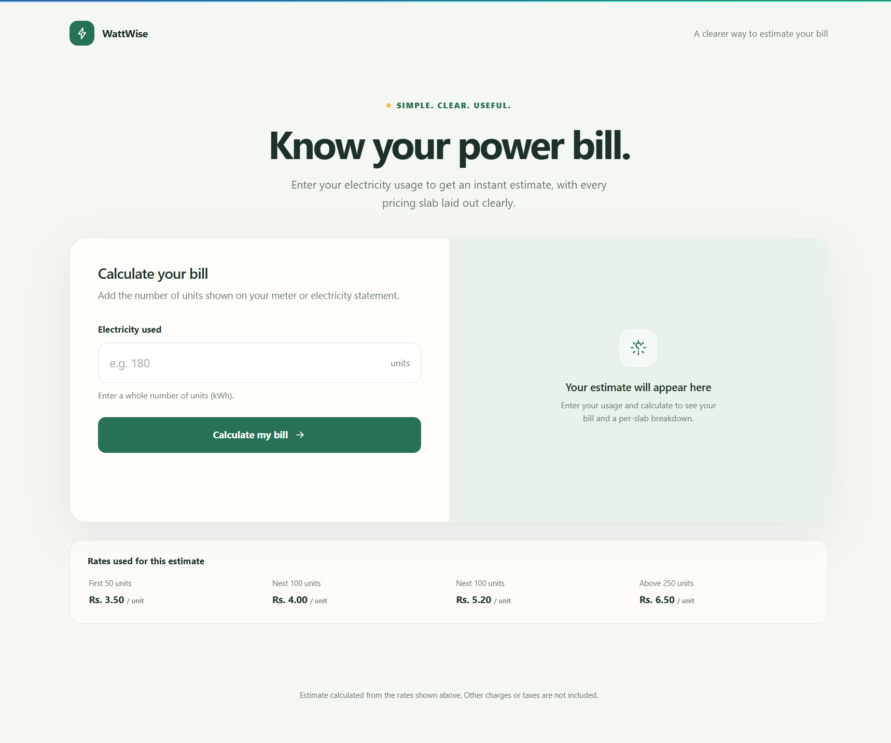
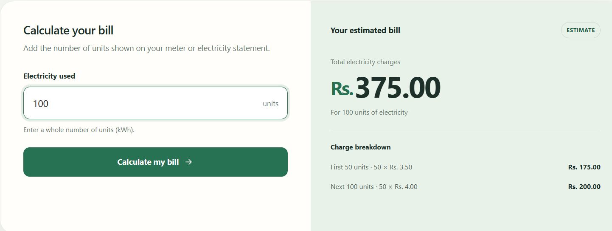
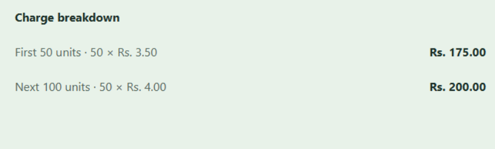

# Electricity Bill Calculator

A web-based assignment project that estimates an electricity bill from the number of units consumed. Enter the units used to see the total charge and a clear breakdown of the progressive rates applied to each slab.

## Features

- Calculates charges using progressive unit slabs.
- Shows the total estimate and per-slab breakdown without reloading the page.
- Validates that the input is a non-negative whole number.
- Displays an estimate for zero units as well.
- Responsive interface built with Bootstrap and custom CSS.

## Electricity rates

| Slab | Rate |
| --- | ---: |
| First 50 units | Rs. 3.50 per unit |
| Next 100 units (51–150) | Rs. 4.00 per unit |
| Next 100 units (151–250) | Rs. 5.20 per unit |
| Above 250 units | Rs. 6.50 per unit |

The calculator applies each rate only to the units in its slab. For example, 180 units cost `50 × 3.50 + 100 × 4.00 + 30 × 5.20 = Rs. 531.00`.

> This is an estimate based on the rates above. Taxes, fixed fees, and other charges are not included.

## Requirements

- PHP 8.1 or later
- A modern web browser
- Internet access to load Bootstrap and jQuery from their CDNs

No database or package installation is required.

## Run locally

1. Open a terminal in the project directory.
2. Start PHP's built-in development server:

   ```sh
   php -S localhost:8000
   ```

3. Open [http://localhost:8000](http://localhost:8000) in your browser.

## Project files

| File or folder | Purpose |
| --- | --- |
| `index.html` | Calculator interface and displayed rates |
| `app.js` | Input validation, form submission, and result rendering |
| `calculate.php` | Validates the request and calculates the bill as JSON |
| `styles.css` | Responsive page styling |
| `Screenshots/` | Screenshots of the calculator and its results |

## Screenshots

### Calculator



### Calculated units



### Charge breakdown


